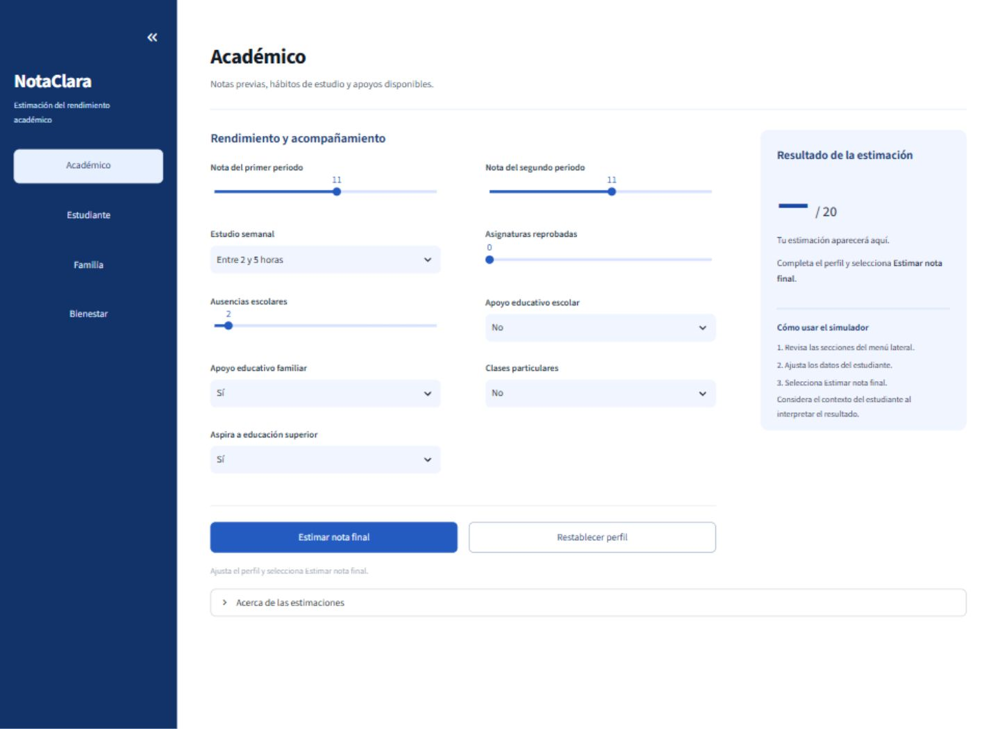
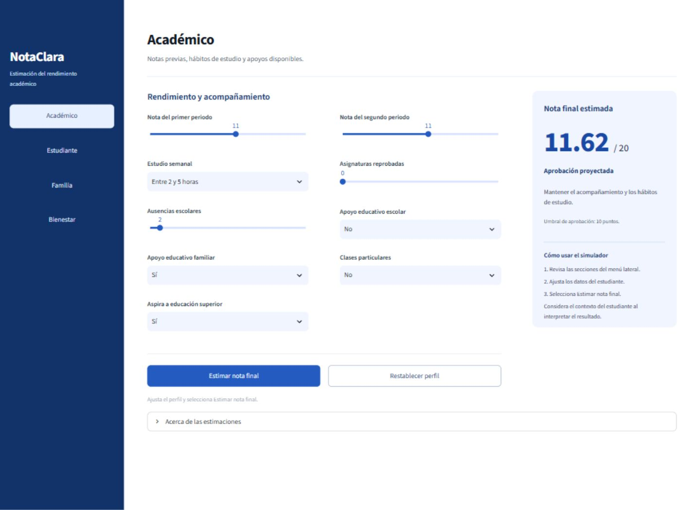
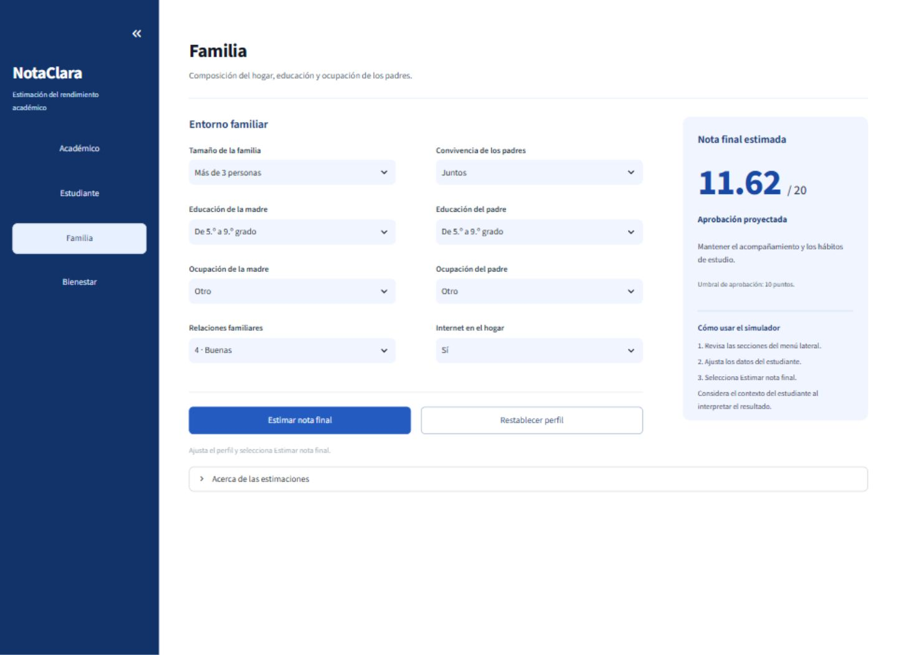
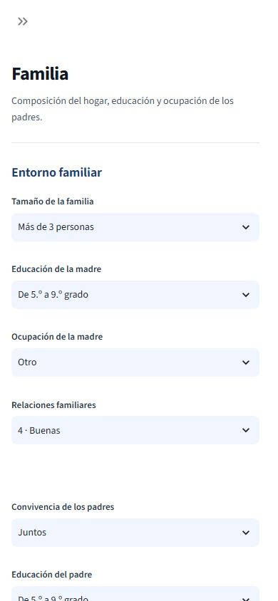

# NotaClara — Predicción de notas de alumnos

Aplicación de **Streamlit** para estimar la nota final de un estudiante de secundaria. Mantiene el menú lateral Académico, Estudiante, Familia y Bienestar, la paleta blanca y azul, los controles en español y la conservación del perfil al navegar. La interfaz se abre como una aplicación web, sin ejecutar cuadernos.

## Instalación y ejecución

Entorno probado: **Python 3.13**. Las versiones de las dependencias están fijadas en requirements.txt y coinciden con el modelo incluido.

Desde la carpeta del proyecto, en PowerShell de VS Code:

```powershell
python -m venv .venv
.\.venv\Scripts\python.exe -m pip install -r requirements.txt
.\.venv\Scripts\python.exe -m streamlit run app.py
```

Abre **http://localhost:8501** si el navegador no se abre automáticamente. Deja la terminal en ejecución. Para detener la aplicación, presiona Ctrl+C.

En Linux o macOS:

```bash
python3 -m venv .venv
.venv/bin/python -m pip install -r requirements.txt
.venv/bin/python -m streamlit run app.py
```

Para ejecutar Streamlit localmente no necesitas un servidor Jupyter ni ngrok. No ejecutes app.py directamente con python: usa **python -m streamlit run app.py**.

## Estructura

```text
app.py                         Interfaz Streamlit y navegación
crear_notebook.py              Genera el cuaderno académico
run_pipeline.py                Ejecuta el análisis completo y genera informes
archive/                       Datos de respaldo originales
data/raw/                      CSV original y archivo comprimido
data/processed/                Índices de entrenamiento y prueba
models/                        Pipeline entrenado y métricas
notebooks/                     Análisis académico de las 16 etapas
reports/tables/                Tablas T1 a T9
reports/figures/               Figuras del análisis y evaluación
src/                           Carga, preprocesamiento, modelos, evaluación e inferencia
requirements.txt               Dependencias compatibles
README.md                      Documentación del proyecto
.streamlit/config.toml         Tema blanco y azul
assets/capturas/               Capturas reales de Streamlit
tests/                         Pruebas de datos, entrenamiento y navegación
```

Se conserva la estructura académica original. Los nombres propios de las variables del código están en español; las APIs de Python y de las bibliotecas conservan sus nombres oficiales. El CSV mantiene sus códigos originales para preservar la compatibilidad y sus columnas se traducen al cargarlo.

Para reproducir el análisis, generar las tablas y figuras y actualizar el modelo que utiliza Streamlit:

```bash
python run_pipeline.py
```

Para regenerar el cuaderno de análisis:

```bash
python crear_notebook.py
```

El cuaderno `notebooks/Estimacion_Nota_Final_16_Etapas.ipynb` documenta el análisis. La interfaz de usuario se abre con `python -m streamlit run app.py`.

## Uso de la aplicación

1. Selecciona una sección del menú lateral. La sección activa queda resaltada y su nombre aparece en el encabezado.
2. Modifica los datos del estudiante. Las escalas se muestran como opciones descriptivas, por ejemplo Entre 2 y 5 horas o Educación secundaria.
3. Selecciona **Estimar nota final**. El resultado aparece en el panel de la derecha; en pantallas estrechas pasa debajo del formulario.
4. **Restablecer perfil** recupera medianas y modas del conjunto de datos y conserva la sección seleccionada.

El perfil persiste al cambiar de sección. Editar un dato invalida el resultado anterior para evitar mostrar una estimación desactualizada. Cambiar solo de sección conserva la última estimación. En móvil, el control superior abre o cierra el menú lateral.

La escala es de 0 a 20 y el umbral utilizado para la aprobación proyectada es **10 puntos**, coherente con el conjunto portugués original. No se aplica el umbral peruano de 11. Las predicciones fuera de la escala se advierten y no se recortan silenciosamente.

Las estimaciones orientan el acompañamiento educativo; no sustituyen la evaluación docente ni deben determinar decisiones automáticas sobre un estudiante.

## Datos, fuente Kaggle y licencia

- Fuente utilizada en el proyecto: [Student Performance Data Set, Kaggle](https://www.kaggle.com/datasets/larsen0966/student-performance-data-set).
- Fuente original y descripción de los atributos: [Student Performance, UCI](https://archive.ics.uci.edu/dataset/320/student+performance).
- Autores: Paulo Cortez y Alice Silva, Universidade do Minho, Portugal. Referencia original: *Using data mining to predict secondary school student performance* (2008).
- Licencia del conjunto original: [Creative Commons Attribution 4.0 International](https://creativecommons.org/licenses/by/4.0/), publicada por UCI. Permite redistribuirlo con atribución.

Se incluye **student-por.csv**, con **649 estudiantes y 33 columnas**: 32 predictores y la nota final. Corresponde a Lengua Portuguesa en dos escuelas de Portugal. El archivo almacenado se conserva con sus nombres originales; al cargarlo, data.py traduce las columnas al español. Los códigos categóricos del CSV no se modifican.

SHA-256 del CSV incluido:

```text
5be7b02f13f5800fddd66e2c8d834cd00ece14c552fb404def2397b31b63236b
```

Si necesitas obtenerlo de nuevo, descarga student-por.csv de la fuente anterior y colócalo en **data/raw/student-por.csv**. El lector admite delimitadores coma y punto y coma, verifica las 33 columnas, los tipos numéricos, valores infinitos, la nota objetivo entre 0 y 20 y columnas completamente vacías. La ficha de datos dentro de la aplicación describe las variables.

Los datos son de estudiantes portugueses y no se ha validado su generalización a otra población o sistema educativo. Las notas de los dos primeros periodos están disponibles en el escenario tardío; excluirlas cambia el problema y su precisión.

## Modelo y reproducción del entrenamiento

El artefacto **models/modelo_final.joblib** contiene el pipeline completo: imputación por mediana para números, imputación por moda para categorías, escalado estándar, OneHotEncoder con categorías desconocidas ignoradas y estimador final. Todas las transformaciones se ajustan dentro de los pliegues de entrenamiento.

Para generarlo de nuevo **antes de ejecutar la aplicación**, desde la raíz:

```powershell
.\.venv\Scripts\python.exe -m src.ml --entrenar
```

O, con el entorno ya activado:

```bash
python -m src.ml --entrenar
```

El proceso usa semilla **42**, entrenamiento **80 % (519 registros)**, prueba reservada **20 % (130 registros)** y validación cruzada de **5 pliegues**. Compara regresión lineal, vecinos cercanos, regresión de vectores de soporte y una referencia que predice la media. Optimiza KNN y SVR mediante GridSearchCV y selecciona el menor MAE de validación cruzada entre los candidatos base y optimizados, antes de consultar prueba. El conjunto de prueba no participa en el ajuste ni en la selección.

El pipeline guardado conserva el ajuste de entrenamiento utilizado para medir la prueba; no se reajusta posteriormente con las notas de los registros reservados. El informe JSON incluye los índices, parámetros, versiones y la huella del CSV.

Resultados del entrenamiento incluido:

| Métrica de prueba | Valor |
|---|---:|
| MAE | 0.697 puntos |
| RMSE | 1.154 puntos |
| R² | 0.863 |
| Reducción del MAE frente a la media | 70.88 % |

El modelo seleccionado fue **Regresión de vectores de soporte**. El MAE es un promedio observado, no un intervalo de confianza para cada alumno. Las funciones de ml.py admiten los escenarios temprano y tardío; el modelo incluido corresponde al **tardío**.

## Predicciones desde Python

```python
from src.predict import cargar_pipeline, generar_casos_ejemplo, predecir_observaciones

modelo = cargar_pipeline()
casos = generar_casos_ejemplo()
notas = predecir_observaciones(modelo, casos)
print(notas)
```

La inferencia ordena las columnas como las espera el pipeline, detecta variables faltantes y permite tratar categorías nuevas y nulos mediante el preprocesamiento. Carga solo modelos de confianza. La aplicación avisa si falta el artefacto o si la versión de scikit-learn no coincide; reinstala requirements.txt o vuelve a entrenarlo en ese caso.

## Capturas

Capturas de la aplicación Streamlit en ejecución, no maquetas.

### Académico



### Resultado de una estimación



### Familia



### Vista móvil



## Verificación

Desde la raíz del proyecto:

```powershell
.\.venv\Scripts\python.exe -m unittest discover -s tests -v
```

Las pruebas comprueban integridad y esquema del CSV, las 32 variables del formulario, predicción por lotes, orden de columnas, manejo de nulos y categorías desconocidas, separación del conjunto de prueba, serialización y recarga del modelo. AppTest de Streamlit comprueba las cuatro secciones, persistencia de valores, cálculo, invalidación de resultados y restablecimiento.

Documentación técnica: [Streamlit](https://docs.streamlit.io/), [estado de widgets](https://docs.streamlit.io/develop/concepts/architecture/widget-behavior) y [pruebas de aplicaciones](https://docs.streamlit.io/develop/api-reference/app-testing/st.testing.v1.apptest).

## Ejecutar Streamlit desde Google Colab

Ejecuta estas celdas en orden. Mantén activa la sesión de Colab mientras utilizas la aplicación.

1. Clona el repositorio y entra en su carpeta:

```python
!git clone https://github.com/gianxxcb/G5_Sistemas_Inteligentes_T9.git
%cd /content/G5_Sistemas_Inteligentes_T9
```

2. Instala las dependencias en un entorno aislado para evitar conflictos con los paquetes propios de Colab. Este método no requiere ensurepip:

```python
import subprocess, sys, venv
from pathlib import Path

entorno = Path('/content/predicciones_env')
venv.EnvBuilder(with_pip=False).create(entorno)
python_app = str(entorno / 'bin/python')
subprocess.run([sys.executable, '-m', 'pip', '--python', python_app,
                'install', '-r', 'requirements.txt'], check=True)
%pip install -q pyngrok
```

3. Inicia Streamlit y crea el enlace. Introduce un authtoken de tu cuenta de ngrok cuando se solicite; no lo guardes en GitHub:

```python
import getpass, subprocess, time, urllib.request
from pyngrok import ngrok

ngrok.set_auth_token(getpass.getpass('Authtoken de ngrok: '))
tunel = ngrok.connect(8501)
anfitrion = tunel.public_url.split('://', 1)[1]
registro = open('/content/streamlit.log', 'w')
proceso = subprocess.Popen([
    python_app, '-m', 'streamlit', 'run', 'app.py',
    '--server.port=8501', '--server.address=0.0.0.0',
    '--server.headless=true', '--browser.serverAddress=' + anfitrion,
    '--browser.serverPort=443'
], stdout=registro, stderr=subprocess.STDOUT)
for intento in range(60):
    if proceso.poll() is not None:
        raise RuntimeError(Path('/content/streamlit.log').read_text())
    try:
        urllib.request.urlopen('http://127.0.0.1:8501/_stcore/health', timeout=2)
        break
    except OSError:
        time.sleep(1)
else:
    raise RuntimeError('El servidor no respondió. Revisa /content/streamlit.log')
print('Abre este enlace en otra pestaña:', tunel.public_url)
```

Abre el enlace que imprime la última celda. La interfaz es Streamlit; no necesitas abrir ningún cuaderno del proyecto. Si ngrok muestra una pantalla de acceso inicial, continúa al sitio. El enlace permite acceder a la sesión mientras el túnel está abierto.

Para detenerla:

```python
proceso.terminate()
ngrok.disconnect(tunel.public_url)
registro.close()
```
